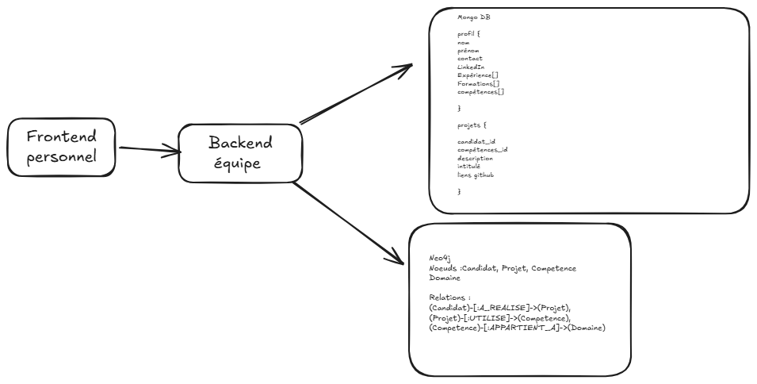
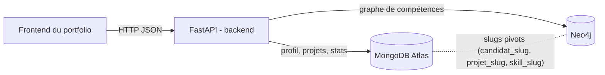
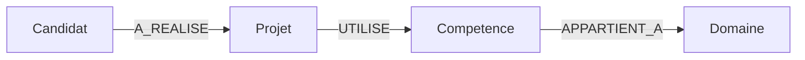

# 🧠 ARCHITECTURE - Équipe `portfolio-<Black Hat>`

> **Jalon 1** : ce document est la **spécification** du projet.
> Projet individuel : un portfolio pour une seule personne, avec un frontend et un backend FastAPI.

# 1. Schéma d'architecture

Le frontend appelle uniquement l'API FastAPI. L'API interroge MongoDB (documents) ou Neo4j (relations), jamais le frontend directement.




t
**Rôle de chaque base :**

- **MongoDB** stocke les données *descriptives* : la collection `candidats` (profil, expériences, formations, compétences) et la collection `projets` (détails de chaque projet). Elle sert aussi les agrégations (statistiques et top des compétences).
- **Neo4j** stocke les *relations* : `Candidat → Projet → Compétence → Domaine`. Elle sert les requêtes de parcours de graphe : projets similaires, graphe de compétences, compétences d'un domaine.
- Les deux bases sont reliées par des **slugs** identiques (section 5). L'API fusionne les résultats si besoin.

## 2. Les requêtes à servir

| # | Besoin (vu par un recruteur) | Route API | Base(s) interrogée(s) |
|---|---|---|---|
| R1 | Profil + timeline (expériences, formations) du candidat | `GET /api/profil` | MongoDB |
| R2 | Projets du candidat, filtrables par compétence | `GET /api/projets` | MongoDB |
| R3 | Statistiques par compétence | `GET /api/stats/competences` | MongoDB |
| R4 | Projets similaires à un projet | `GET /api/graph/projets/{projet_slug}/similaires` | Neo4j |
| R5 | Graphe de compétences du candidat | `GET /api/graph/competences` | Neo4j |
| R6 | Top N des compétences les plus utilisées | `GET /api/competences/top?n=5` | MongoDB |
| R7 | Compétences d'un domaine donné | `GET /api/graph/domaines/{domaine_slug}/competences` | Neo4j |
| R8 | Expériences filtrées par lieu | `GET /api/experiences?lieu=...` | MongoDB |

## 3. Modèle MongoDB

### 3.1 Collection `candidats` - pattern *Embedding*

```json
{
  "candidat_slug": "exemple-candidat",
  "prenom": "Alice",
  "nom": "Martin",
  "titre": "Élève-ingénieure Big Data — ESIGELEC",
  "bio": "Passionnée par les bases de données NoSQL et le développement d'API.",
  "email": "alice.martin@example.com",
  "liens": {
    "github": "https://github.com/exemple",
    "linkedin": "https://www.linkedin.com/in/exemple"
  },
  "experiences": [
    {
      "entreprise": "Entreprise X",
      "poste": "Stagiaire Data Engineer",
      "lieu": "Rouen",
      "debut": "2026-04",
      "fin": "2026-08",
      "description": "Pipeline d'ingestion de données.",
      "competences": ["python", "mongodb", "airflow"]
    }
  ],
  "formations": [
    {
      "ecole": "ESIGELEC",
      "diplome": "Cycle ingénieur — Big Data (BDTN)",
      "lieu": "Saint-Étienne-du-Rouvray",
      "debut": "2024-09",
      "fin": "2027-06"
    }
  ],
  "competences": [
    { "skill_slug": "mongodb", "nom": "MongoDB", "domaine": "bases-de-donnees", "niveau": 3 },
    { "skill_slug": "python", "nom": "Python", "domaine": "langages", "niveau": 4 }
  ]
}
```

**Justification** : le portfolio ne contient qu'**un seul candidat**, avec des `experiences`, `formations` et `competences` en nombre **borné** (quelques dizaines au maximum). Ces données sont **toujours lues avec le profil** : R1 se fait en une seule requête, sans jointure ni `$lookup`. Elles sont **rarement modifiées** (quelques fois par an), donc aucun risque lié à la mise à jour de sous-documents. R8 filtre simplement le tableau embarqué `experiences` par `lieu`.

### 3.2 Collection `projets` - pattern *Referencing*

```json
{
  "projet_slug": "smartcity-explorer",
  "candidat_slug": "exemple-candidat",
  "titre": "SmartCity Explorer",
  "description": "Application de visualisation de données urbaines.",
  "description_longue": "Tableau de bord interactif alimenté par des données ouvertes sur la mobilité et l'énergie.",
  "annee": 2026,
  "competences": ["mongodb", "fastapi", "neo4j"],
  "lien_repo": "https://github.com/exemple/smartcity-explorer",
  "lien_demo": null
}
```

**Justification** : les projets sont dans une **collection séparée**, reliée au candidat par `candidat_slug` (*Referencing*), car leur nombre **n'est pas borné** (il augmente au fil des années) et ils sont **filtrés, paginés et agrégés indépendamment du profil** (R2, R3, R6). Les `competences` d'un projet sont une liste de `skill_slug` **embarquée** : elle est courte, toujours lue avec le projet, et directement utilisable par `$unwind` pour les statistiques.

### 3.3 Index

| Collection | Index | Requête servie (R#) |
|---|---|---|
| `candidats` | `{ candidat_slug: 1 }` **unique** | R1, R8 (accès direct au document) |
| `candidats` | `{ "experiences.lieu": 1 }` | R8 (filtre par lieu) |
| `projets` | `{ projet_slug: 1 }` **unique** | R2 (détail d'un projet) |
| `projets` | `{ candidat_slug: 1, annee: -1 }` | R2 (liste triée par année) |
| `projets` | `{ competences: 1 }` (multikey) | R2 (filtre par compétence), R3, R6 |

```javascript
db.candidats.createIndex({ candidat_slug: 1 }, { unique: true })
db.candidats.createIndex({ "experiences.lieu": 1 })
db.projets.createIndex({ projet_slug: 1 }, { unique: true })
db.projets.createIndex({ candidat_slug: 1, annee: -1 })
db.projets.createIndex({ competences: 1 })
```

### 3.4 Pipeline d'agrégation clé (R3)

```javascript
db.projets.aggregate([
  { $match: { candidat_slug: "exemple-candidat" } },
  { $unwind: "$competences" },
  { $group: {
      _id: "$competences",
      nb_projets: { $sum: 1 },
      derniere_annee: { $max: "$annee" }
  } },
  { $sort: { nb_projets: -1, _id: 1 } },
  { $project: { _id: 0, competence: "$_id", nb_projets: 1, derniere_annee: 1 } }
])
```

R6 réutilise le même pipeline en ajoutant `{ $limit: n }` après le `$sort`.

## 4. Modèle Neo4j

### 4.1 Schéma du graphe



| Label | Propriétés | Clé unique |
|---|---|---|
| `Candidat` | `candidat_slug`, `prenom`, `nom` | `candidat_slug` |
| `Projet` | `projet_slug`, `titre`, `annee` | `projet_slug` |
| `Competence` | `skill_slug`, `nom`, `niveau` | `skill_slug` |
| `Domaine` | `domaine_slug`, `nom` | `domaine_slug` |

| Relation | De → Vers | Propriétés | Pourquoi ce sens |
|---|---|---|---|
| `A_REALISE` | `Candidat → Projet` | aucune | Le candidat est l'auteur du projet. |
| `UTILISE` | `Projet → Competence` | aucune | Un projet mobilise des compétences ; on remonte aux projets similaires en passant par une compétence commune. |
| `APPARTIENT_A` | `Competence → Domaine` | aucune | Chaque compétence est classée dans un domaine (par exemple MongoDB dans `bases-de-donnees`). |

### 4.2 Les 3 requêtes Cypher clés

```cypher
// R4 - projets similaires (projets partageant des compétences)
MATCH (p:Projet {projet_slug: $projet_slug})-[:UTILISE]->(c:Competence)<-[:UTILISE]-(autre:Projet)
WHERE autre <> p
RETURN autre.projet_slug AS projet_slug,
       autre.titre AS titre,
       collect(c.skill_slug) AS competences_communes,
       count(c) AS nb_communes
ORDER BY nb_communes DESC
LIMIT $limit

// R5 - graphe de compétences du candidat (le backend transforme en nodes/links)
MATCH (ca:Candidat)
OPTIONAL MATCH (ca)-[:A_REALISE]->(p:Projet)
OPTIONAL MATCH (p)-[:UTILISE]->(c:Competence)
OPTIONAL MATCH (c)-[:APPARTIENT_A]->(d:Domaine)
RETURN ca {.candidat_slug, .prenom, .nom} AS candidat,
       p  {.projet_slug, .titre, .annee}  AS projet,
       c  {.skill_slug, .nom, .niveau}    AS competence,
       d  {.domaine_slug, .nom}           AS domaine
// R7 - compétences d'un domaine
MATCH (d:Domaine {domaine_slug: $domaine_slug})<-[:APPARTIENT_A]-(c:Competence)
RETURN d.domaine_slug AS domaine_slug, d.nom AS domaine_nom,
       c.skill_slug AS skill_slug, c.nom AS nom
ORDER BY c.nom
```

### 4.3 Contraintes

```cypher
CREATE CONSTRAINT candidat_slug IF NOT EXISTS FOR (c:Candidat) REQUIRE c.candidat_slug IS UNIQUE;
CREATE CONSTRAINT projet_slug IF NOT EXISTS FOR (p:Projet) REQUIRE p.projet_slug IS UNIQUE;
CREATE CONSTRAINT skill_slug IF NOT EXISTS FOR (s:Competence) REQUIRE s.skill_slug IS UNIQUE;
CREATE CONSTRAINT domaine_slug IF NOT EXISTS FOR (d:Domaine) REQUIRE d.domaine_slug IS UNIQUE;
```

Ces contraintes créent aussi un index sur chaque slug, ce qui accélère les `MATCH` de R4, R5 et R7.

## 5. Cohérence entre les bases (slugs pivots)

| Entité | Slug | Dans MongoDB | Dans Neo4j |
|---|---|---|---|
| Candidat | `candidat_slug` (ex. `exemple-candidat`) | Champ `candidat_slug` de `candidats` ; référence dans chaque document de `projets`. | Propriété `candidat_slug` du nœud `Candidat`. |
| Projet | `projet_slug` (ex. `smartcity-explorer`) | Champ `projet_slug` de `projets` (unique). | Propriété `projet_slug` du nœud `Projet` (unique). |
| Compétence | `skill_slug` (ex. `mongodb`) | Dans `candidats.competences[].skill_slug`, `candidats.experiences[].competences` et `projets.competences`. | Propriété `skill_slug` du nœud `Competence` (unique). |

**Suppression d'un projet** :

- **MongoDB** : `db.projets.deleteOne({ projet_slug })`.
- **Neo4j** : `MATCH (p:Projet {projet_slug: $projet_slug}) DETACH DELETE p` supprime le nœud et ses relations `A_REALISE` et `UTILISE`.
- Les nœuds `Competence` et `Domaine` **ne sont pas supprimés** : ils sont partagés avec d'autres projets et gardent leur sens dans le profil.
- Ordre : MongoDB d'abord (source de vérité), puis Neo4j. Si Neo4j échoue, l'API renvoie une erreur et le script de synchronisation relance la suppression. Il n'y a pas de transaction distribuée entre les deux bases.

## 6. Répartition du travail

> Le frontend n'est pas attribué dans cette répartition. Les tâches ci-dessous concernent uniquement le backend, les bases de données et l'intégration logicielle du projet.

| Membre (pseudo GitHub) | Emplacement exact dans le projet | Tâches à réaliser |
|---|---|---|
| `bibou172` | `backend/src/portfolio_api/repositories/`, `backend/src/portfolio_api/api/`, `backend/src/portfolio_api/models/` | Gérer les requêtes MongoDB liées au profil et aux projets : R1, R2, R8, modèles `Candidat` / `Projet`, validation des données métier dans les endpoints de lecture, et contrôle des index de `candidat_slug` / `projet_slug`. |
| `Brina21694` | `backend/src/portfolio_api/repositories/`, `backend/src/portfolio_api/services/`, `backend/src/portfolio_api/api/` | Développer les agrégations MongoDB pour R3 et R6, calculer les statistiques de compétences, préparer la logique de tri et de top N, puis valider les performances des requêtes sur les projets et les compétences. |
| `HilaryBoco06` | `backend/src/portfolio_api/db/neo4j.py`, `backend/src/portfolio_api/repositories/`, `backend/src/portfolio_api/api/` | Mettre en place le schéma Neo4j, les contraintes d'unicité, les routes R4 et R7, les relations `A_REALISE`, `UTILISE` et `APPARTIENT_A`, et vérifier la cohérence des nœuds `Candidat`, `Projet`, `Competence` et `Domaine`. |
| `nicktoudonou-spec` | `backend/src/portfolio_api/services/`, `backend/src/portfolio_api/api/`, `backend/src/portfolio_api/repositories/` | Travailler sur R5, l'orchestration entre MongoDB et Neo4j, la transformation du graphe en réponse API, et la gestion des cas de données incomplètes ou de synchronisation partielle. |
| `PapaDaoudaNDIAYE` | `backend/src/portfolio_api/main.py`, `backend/src/portfolio_api/core/`, `backend/src/portfolio_api/db/`, `backend/src/portfolio_api/scripts/` | Relier les modules, configurer l'API principale, gérer les connexions MongoDB / Neo4j, préparer le seed et la config globale, puis valider l'ensemble des endpoints et la cohérence de la livraison finale. |

### Règles de travail

- Chaque membre doit avoir au moins une responsabilité sur MongoDB et une sur Neo4j, dans le backend.
- Le travail est organisé par dossiers techniques pour éviter la confusion entre API, services, repositories et bases.
- Tous les membres participent à la validation finale du backend, sans dépendre du frontend.

## 7. MVP de l'application

**Entités :**

- Entité 1 : Candidat
- Entité 2 : Expériences
- Entité 3 : Formations
- Entité 4 : Projets
- Entité 5 : Compétences

**Ce que voit le recruteur :**

- Une page d'accueil avec le profil, les liens et les compétences phares (R1, R6).
- Une page « Parcours » avec la timeline des expériences et formations, filtrable par ville (R1, R8).
- Une page « Projets » avec filtre par compétence et, dans le détail d'un projet, les projets similaires (R2, R4).
- Une page « Compétences » avec statistiques et filtre par domaine (R3, R7).
- Une page « Graphe » avec la visualisation des liens projets et compétences (R5).

**Ce que voit le candidat uniquement :**
- Une page « Admin » avec la possibilité de rqjouter dqns la bdd une experiece un projet ou une formation 