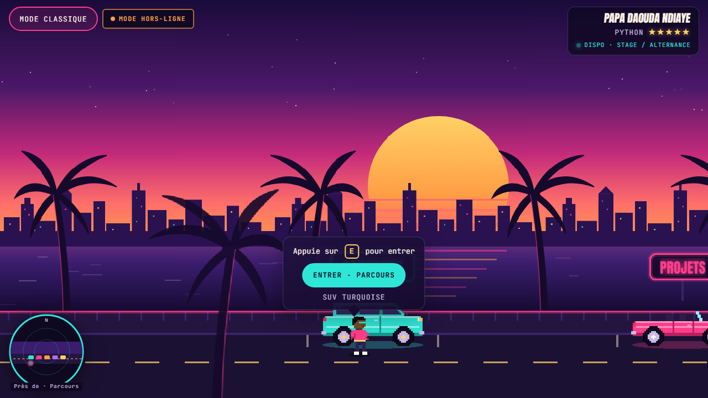
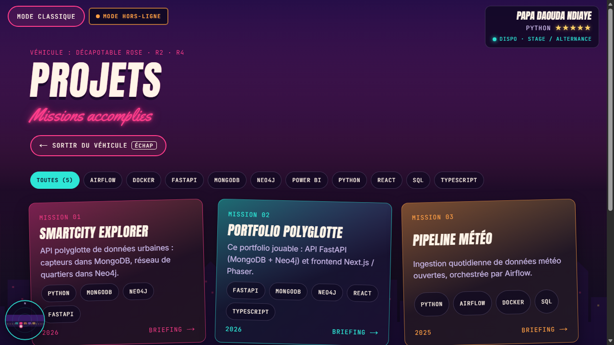
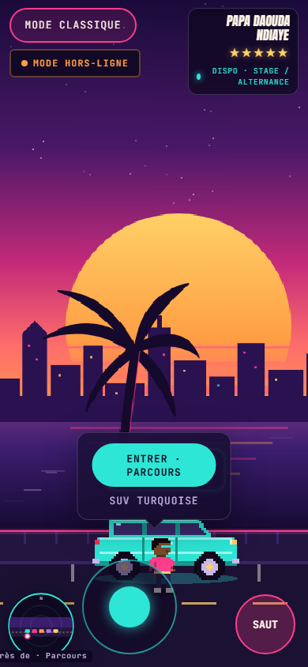

# 🌅 Sunset Drive — le portfolio jouable de @PapaDaoudaNDIAYE

- **Technologie** : Next.js 16 (App Router, TypeScript) + Phaser 3 + Framer Motion
- **Lancer** : `npm install` → `cp .env.example .env.local` → `npm run dev` → <http://localhost:3000> (détails ci-dessous)
- **Routes de l'API consommées** : R1 à R8 d'[ARCHITECTURE.md](../../ARCHITECTURE.md) (tableau ci-dessous)

---

## 1. Présentation

Un portfolio **jouable** dans l'ambiance d'un jeu en monde ouvert, sur une côte au coucher du soleil : néons,
palmiers, soleil rayé, HUD de jeu. L'avatar du candidat se promène dans une rue où sont garées **5 voitures**.
Chacune mène à une section du portfolio : on s'en approche, on appuie sur **E**, la voiture démarre et l'écran
de chargement mène à la section.

Personnage, voitures, décor et logo sont **100 % originaux** : pixel art et SVG dessinés dans le code.
Aucun nom, logo, personnage, musique ou asset d'un jeu existant n'est utilisé.

| La rue | Une section | Sur mobile |
|---|---|---|
|  |  |  |

### Pages et routes de l'API

| Page | Voiture | Contenu | Route(s) de l'API |
|---|---|---|---|
| `/` | — | Écran de chargement + rue jouable (ou accueil classique) | R1 `GET /api/profil` (nom et compétence phare dans le HUD) |
| `/parcours` | SUV turquoise | Radar des villes, filtre par ville, frise des expériences et formations | R1 `GET /api/profil`, R8 `GET /api/experiences?lieu=` |
| `/projets` | Décapotable rose | Cartes « MISSION 01, 02… », filtre par compétence | R2 `GET /api/projets?competence=`, R1 |
| `/projets/[slug]` | Décapotable rose | Briefing du projet + missions similaires | R2 (détail), R4 `GET /api/graph/projets/{slug}/similaires` |
| `/competences` | Muscle car orange | Barres de stats, top 5, onglets par domaine, étoiles | R3 `GET /api/stats/competences`, R6 `GET /api/competences/top?n=5`, R7 `GET /api/graph/domaines/{slug}/competences`, R1 |
| `/graphe` | Coupé violet | Radar animé du graphe Neo4j, liens illuminés au clic | R5 `GET /api/graph/competences` |
| `/contact` | Van jaune | Profil, bio, liens GitHub / LinkedIn / e-mail | R1 `GET /api/profil` |
| `/admin` | — (URL seulement) | Formulaires : ajouter une expérience, un projet, une formation | `POST /api/experiences`, `/api/projets`, `/api/formations` ⚠️ pas encore dans le backend |

> **Détail d'un projet** : ARCHITECTURE.md ne définit pas de route « un projet ». Le client essaie
> `GET /api/projets/{slug}`, puis cherche le projet dans la liste R2.

## 2. Prérequis

| Outil | Version | Vérifier |
|---|---|---|
| Node.js | **20.9 ou plus** (LTS conseillée : 22 ou 24) | `node -v` |
| npm | 10 ou plus (fourni avec Node) | `npm -v` |

Pour avoir les **vraies données**, le backend de l'équipe (FastAPI + MongoDB + Neo4j) doit tourner :
voir le [README principal du dépôt](../../README.md).
**Sans backend, l'appli fonctionne quand même** avec des données de démonstration, et le badge
**MODE HORS-LIGNE** s'affiche dans le HUD.

## 3. Installation

```bash
# 1. Cloner le dépôt
git clone <url-du-depot>
cd <dossier-du-depot>

# 2. Aller dans ce frontend
cd frontends/frontend-PapaDaoudaNDIAYE

# 3. Installer les dépendances
npm install

# 4. Créer le fichier de configuration local
cp .env.example .env.local          # macOS / Linux / Git Bash
copy .env.example .env.local        # Windows (cmd ou PowerShell)
```

### Variables d'environnement (`.env.local`)

| Variable | Défaut | Rôle |
|---|---|---|
| `NEXT_PUBLIC_API_URL` | `http://localhost:8000` | URL de base de l'API FastAPI, **sans `/` final**. Elle est lue côté serveur (pages) et côté navigateur (HUD, jeu, admin). Si l'API ne répond pas en 2,5 s, l'appli passe sur les données de démo. |

`.env.local` n'est pas versionné. Après une modification, relance `npm run dev`.

## 4. Lancer l'application

**Dans l'ordre :**

1. **Démarrer le backend**, depuis la racine du dépôt (voir le README principal) :
   ```bash
   just seed      # remplit MongoDB et Neo4j depuis data/ (une fois)
   just dev       # API sur http://localhost:8000
   # sans just : cd backend && uv run uvicorn portfolio_api.main:app --reload --port 8000
   ```
2. **Vérifier que l'API répond** : ouvre <http://localhost:8000/docs> (Swagger) ou
   <http://localhost:8000/api/health>, qui doit renvoyer `{"status":"ok"}`.
3. **Démarrer le frontend**, dans `frontends/frontend-PapaDaoudaNDIAYE` :
   ```bash
   npm run dev
   ```
4. Ouvre **<http://localhost:3000>**.

| Commande | Rôle |
|---|---|
| `npm run dev` | Serveur de développement (rechargement automatique) |
| `npm run build` | Build de production (vérifie aussi TypeScript) |
| `npm start` | Lance le build de production sur <http://localhost:3000> (après `npm run build`) |
| `npm run lint` | Vérifie le code avec ESLint |

> Tant que les routes R1 à R8 ne sont pas codées dans le backend, l'API répond 404 et le frontend reste en
> **MODE HORS-LIGNE**, même si `/api/health` répond. C'est normal : il bascule automatiquement sur les vraies
> données dès qu'elles existent.

## 5. Comment jouer

| Action | Clavier | Mobile / tactile |
|---|---|---|
| Marcher | `←` `→` · `Q` `D` (AZERTY) · `A` `D` (QWERTY) | Joystick (glisser à gauche / à droite) |
| Sauter | `↑` · `Espace` · `Z` (AZERTY) · `W` (QWERTY) | Bouton **SAUT**, ou glisser le joystick vers le haut |
| Aller à une voiture | — | **Toucher la voiture** : l'avatar y va tout seul (marche aussi au clic) |
| Entrer dans la voiture | `E` (devant une voiture) | Bouton **Entrer** dans la bulle |
| Sortir du véhicule | `Échap` | Bouton **← Sortir du véhicule** |

| Voiture | Section |
|---|---|
| 🚙 SUV turquoise | Parcours |
| 🚗 Décapotable rose | Projets |
| 🏎️ Muscle car orange | Compétences |
| 🚘 Coupé violet | Graphe |
| 🚐 Van jaune | Contact |

En sortant d'une section, la voiture revient se garer et l'avatar réapparaît à côté.

**Mode classique** : le bouton en haut à gauche, toujours visible, remplace le jeu par une navigation HTML
classique vers toutes les sections. Il est pensé pour les recruteurs pressés, la navigation au clavier seul et
les lecteurs d'écran. Le choix est mémorisé.

## 6. Structure du projet

```text
frontends/frontend-PapaDaoudaNDIAYE/
├── app/                      # Routes Next.js (App Router)
│   ├── layout.tsx            #   polices next/font, HUD global, Mode classique, transition
│   ├── page.tsx              #   accueil : écran de chargement + scène (import dynamique, ssr: false)
│   ├── parcours/ projets/ projets/[slug]/ competences/ graphe/ contact/ admin/
│   ├── loading.tsx error.tsx not-found.tsx
│   └── globals.css           #   variables CSS du thème + classes communes
├── components/               # HUD, Minimap, LoadingScreen, TransitionOverlay, MissionGrid, RadarGraph…
├── game/                     # Scène Phaser (chargée seulement dans le navigateur)
│   ├── StreetScene.ts        #   décor en parallaxe, personnage, voitures, entrée / sortie
│   ├── createGame.ts         #   création / destruction du jeu
│   ├── layout.ts             #   positions des voitures (partagées avec la mini-carte)
│   └── sprites/              #   pixel art généré : personnage, voitures, effets
├── lib/
│   ├── api/                  # client typé R1…R8, types, mocks, appels d'écriture (admin)
│   ├── store/                # petits stores partagés React <-> Phaser
│   └── sections.ts           # les 5 sections / voitures (+ astuces de chargement)
├── theme/tokens.ts           # couleurs et polices (côté TypeScript)
├── public/assets/decor/      # SVG originaux : skyline, palmier, illustration du chargement
├── docs/                     # captures d'écran du README
├── .env.example              # NEXT_PUBLIC_API_URL=http://localhost:8000
└── AGENTS.md                 # notes générées par Next.js pour les assistants de code
```

## 7. Modifier le contenu ou le style

- **Couleurs** : variables `:root` de `app/globals.css` (pages) **et** `theme/tokens.ts` (jeu).
  Les couleurs des voitures sont dans `game/sprites/cars.ts` (`PALETTES`).
- **Polices** : `app/layout.tsx` (`next/font/google` : Anton, Yellowtail, Inter, JetBrains Mono).
  Les classes `.title`, `.neon` et `.mono` sont dans `globals.css`.
- **Ajouter une voiture / section** :
  1. ajoute une entrée dans `lib/sections.ts` (id, libellé, couleur, style de voiture) ;
  2. crée la page `app/<id>/page.tsx` (copie une section existante : `SectionShell` + `Suspense`) ;
  3. pour un nouveau style de voiture, ajoute-le dans `SPECS` et `PALETTES` de `game/sprites/cars.ts`.
  La voiture, son panneau néon et son repère sur la mini-carte apparaissent automatiquement.
- **Remplacer les mocks** : les données de démo sont dans `lib/api/mocks.ts`. Les formats attendus de
  l'API sont typés dans `lib/api/types.ts`. Une liste peut être un tableau ou une réponse paginée
  `{items, total, page, size}`.
- **Astuces de l'écran de chargement** : `TIPS` dans `lib/sections.ts`.

## 8. Dépannage

| Problème | Solution |
|---|---|
| Erreur **CORS** dans la console du navigateur | Le backend doit autoriser l'origine du frontend : `CORS_ORIGINS` dans le `.env` du backend doit contenir `http://localhost:3000` (déjà le cas dans la config de l'équipe ; ajoute `http://localhost:3001` si tu changes de port), puis redémarre l'API. |
| Badge **MODE HORS-LIGNE** | L'API est éteinte, trop lente (> 2,5 s), ou la route n'existe pas encore (404). Vérifie <http://localhost:8000/docs> et `NEXT_PUBLIC_API_URL`. |
| Port 3000 déjà utilisé | `npm run dev -- -p 3001` (et ajoute ce port dans `CORS_ORIGINS` du backend) |
| `window is not defined` / `document is not defined` | Du code navigateur s'exécute côté serveur. Phaser doit rester importé via `dynamic(() => import(...), { ssr: false })` dans un composant `"use client"` (voir `components/HomeClient.tsx`). |
| Le jeu ne bouge pas au clavier | Clique d'abord dans la page (le focus doit être dans la fenêtre du navigateur). |
| Comportement bizarre après une mise à jour | Efface le cache : `rm -rf .next` (Windows PowerShell : `Remove-Item -Recurse -Force .next`), puis relance. |

## 9. Déploiement (optionnel) — Vercel

1. Importe le dépôt sur Vercel et choisis le **Root Directory** `frontends/frontend-PapaDaoudaNDIAYE`.
2. Dans *Settings → Environment Variables*, définis `NEXT_PUBLIC_API_URL` avec l'URL publique de l'API.
3. Ajoute l'URL Vercel (`https://….vercel.app`) dans `CORS_ORIGINS` du backend.

## 10. Auteur

**@PapaDaoudaNDIAYE** : dans l'équipe, je relie les modules du backend (`main.py`, configuration, connexions
MongoDB / Neo4j, seed) et je valide les endpoints et la livraison finale.
Architecture du projet : [ARCHITECTURE.md](../../ARCHITECTURE.md).
